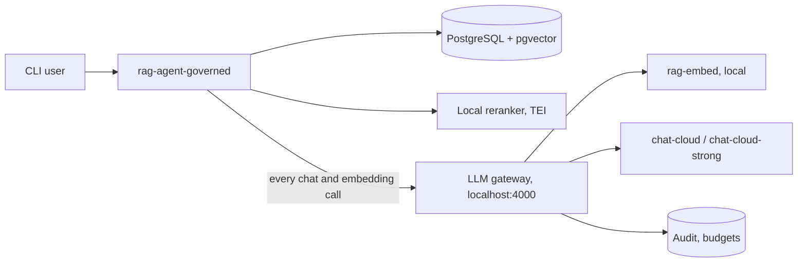

# rag-agent-governed

A governed RAG and agent assistant for a fictional lender, Demo Mortgage Co. It answers policy
questions with code-checked citations and runs a tool-calling agent that can read loan files,
calculate payments and prepare exception requests, but never raise or approve them. By default
every model call goes through the LLM gateway
([llm-gateway-governance](https://github.com/javabbgit/llm-gateway-governance)) and inherits its
governance: PII detection, residency routing, budgets and audit. A direct mode can point at any
OpenAI-compatible endpoint. Agent rules are in [AGENTS.md](AGENTS.md).

## Results at a glance

All numbers are copied from the reports in [docs/results/](docs/results/README.md); the file is
named next to each one.

- **Retrieval (50 answerable test questions).** Document-level Hit@1 is 0.8000 for hybrid search
  and 0.9200 with reranking, an observed difference; the report gives no interval for it. Paired
  differences, rerank minus hybrid: MRR@10 0.0266 [-0.0411, 0.0956] and chunk-level Hit@1
  0.0400 [-0.0600, 0.1600]; both intervals include 0, so neither is significant.
  ([retrieval_test_d5.md](docs/results/retrieval_test_d5.md))
- **Fallback (test).** The score gate sends 11/12 out-of-corpus questions to fallback
  (0.9167 [0.7500, 1.0000]) and 9/50 answerable questions to fallback by mistake
  (0.1800 [0.0800, 0.2800]) ([fallback_test_d5.md](docs/results/fallback_test_d5.md)). End to
  end, over 3 generations per question, correct fallback is 36/36 and false fallback 34/150
  ([answer_test_d10.md](docs/results/answer_test_d10.md)). The gate passed T62, and the model
  declined it in all 3 generations; the superseded_only rule did not fire.
- **Cited answers (test).** 115/116 answers cite a gold chunk, and 0/123 have an invalid citation
  ([answer_test_d10.md](docs/results/answer_test_d10.md)). Of the manually checked sentences,
  37/37 are supported by their source
  ([answer_review_d10.csv](docs/results/answer_review_d10.csv)).
- **Agent tasks (test, Haiku 5.5).** pass@1 is 0.907 [0.813, 0.987] (68/75 runs), and the policy
  invariant checks pass 480/480
  ([agent_test_haiku_d8.md](docs/results/agent_test_haiku_d8.md)).
- **Injection.** 0 unauthorized side effects or reads in 54 runs with defenses on, vs 7 of 54 runs
  with all defenses off. With defenses off, 4 side-effect calls reached the executor (3 persisted,
  1 rejected by a database constraint), plus 3 out-of-scope reads
  ([attack_on_d9.md](docs/results/attack_on_d9.md),
  [attack_off_d9.md](docs/results/attack_off_d9.md)).
- **No false positives from the defenses.** With all defenses on, a rerun of the D8 agent test
  passes the policy checks 480/480
  ([false_positive_rerun_d9.md](docs/results/false_positive_rerun_d9.md)). 0 of 20 denied tool
  calls across the three agent test reports were wrong
  ([denials_d9.csv](docs/results/denials_d9.csv)).

## Demo

Videos: coming soon.

## How it fits with the gateway

| Concern | This repository | Gateway (llm-gateway-governance) |
|---|---|---|
| Retrieval, reranking, fallback gate | yes | - |
| Citation validation, answer messages | yes | - |
| Agent loop, tool policy, approvals, tools.lock | yes | - |
| Role-based data scope on loan files | yes | - |
| PII detection and redaction (rules such as R5) | chunk pre-scans only | yes, on every request |
| Residency routing, model aliases (chat-cloud, chat-cloud-strong, rag-embed) | - | yes |
| Budgets and audit log | - | yes |
| Error taxonomy | maps gateway errors to fixed messages | produces them |



Run modes (`LLM_MODE`):

- **gateway** (default): `OPENAI_BASE_URL` points at the gateway. Errors fail closed, with no
  fallback to direct mode or to another model alias. This mode needs
  github.com/javabbgit/llm-gateway-governance, branch `rag-agent-integration`, at commit
  `968ca53`.
- **direct**: `OPENAI_BASE_URL` and `CHAT_MODEL` point at any OpenAI-compatible chat endpoint.
  Embeddings use the bundled Ollama (`EMBED_BASE_URL`, `EMBED_MODEL`). Direct mode has none of
  the gateway's governance.

Only [src/rag_agent/llm_client.py](src/rag_agent/llm_client.py) constructs a model client.

## Quickstart

Requirements: Python 3.11 with uv, Docker. Copy `.env.example` to `.env` and fill it in. Keys
are read from the environment only.

Direct mode (`LLM_MODE=direct`):

```bash
make setup
make up-direct           # pgvector, Ollama and the local reranker
make db-init
make ingest              # COLLECTION=main, DOCS_DIR=corpus/docs
make agent-seed          # mock loan files, users and contacts
make smoke
make ask Q="What is the maximum TDS ratio?"
make agent Q="What is the status of DMC-2026-00101?" AS=uw-01
```

Gateway mode (`LLM_MODE=gateway`, the gateway running on localhost:4000):

```bash
make setup
docker compose up -d     # pgvector and the local reranker (Ollama has its own profile)
make db-init
make corpus-prescan      # every chunk through the gateway's rag-embed
make ingest
make agent-seed
make smoke               # includes the PII probe
make reranker-check
make ask Q="What is the maximum TDS ratio?"
make agent Q="What is the status of DMC-2026-00101?" AS=uw-01
```

`make lint` and `make test` run without network or gateway. `make test-db` resets the agent
tables, so run `make agent-seed` after it.

## Architecture

**Retrieval** ([src/rag_agent/retrieve.py](src/rag_agent/retrieve.py)). BM25 and exact vector
search (nomic embeddings with task prefixes) are fused with reciprocal rank fusion. All
retrieval parameters live in one constant block.

**Local reranker** ([src/rag_agent/rerank.py](src/rag_agent/rerank.py)). bge-reranker-base runs
in a Text Embeddings Inference container and reranks the top 10 hybrid candidates. It runs only
after the gateway has accepted the query embedding. If the reranker fails, scripts stop
(fail closed); they never fall back silently to hybrid results.

**Fallback gate.** If the top-1 rerank score is below the committed dev threshold
(t = 0.062085786500000004, [answer_test_d10.md](docs/results/answer_test_d10.md)), the
question goes to fallback without a chat call.

**Cited generation** ([src/rag_agent/answer.py](src/rag_agent/answer.py)). The top 5 chunks go
to the model as sources S1 to S5. [src/rag_agent/citations.py](src/rag_agent/citations.py) checks
in code that every sentence carries a marker and that every marker points to a source given in
this request. An uncited answer or an explicit decline is turned into fallback.

**Gateway error handling** ([src/rag_agent/errors.py](src/rag_agent/errors.py),
[src/rag_agent/messages.py](src/rag_agent/messages.py)). A classifier tested against recorded
fixtures in `tests/fixtures/gateway_errors/` maps gateway errors to fixed user messages. Policy,
auth, allow-list and budget errors are never retried, raw gateway text is never shown, and
`LLM_MAX_RETRIES` defaults to 0.

**Agent loop** ([src/rag_agent/agent/loop.py](src/rag_agent/agent/loop.py)). A single
tool-calling loop over `LLMClient.chat_tools` with no retries. Every tool call goes through
[src/rag_agent/agent/policy.py](src/rag_agent/agent/policy.py). The five tools:

| Tool | Effect |
|---|---|
| `search_policy` | retrieval over the policy corpus |
| `get_loan_status` | reads a loan file within the user's data scope |
| `calculate_payment` | payment and GDS/TDS calculation; policy numbers from `corpus/facts.toml` |
| `prepare_exception_request` | writes an exception request in status `awaiting_raise` |
| `draft_reply` | writes a reply draft (status `draft`); nothing is sent |

## Agent governance

**Seven defense switches** in [config/agent_policy.toml](config/agent_policy.toml), all on by
default: `role_allowlist`, `schema_validation`, `tool_pinning`, `scope_check`,
`arg_provenance`, `approval_gate`, `data_envelope`. Switching any of them off requires
`AGENT_DEFENSES_OFF_ACK=1` and is allowed only in tests, governance drills and attack runs.

**Two human gates with maker-checker.** The agent can only prepare a draft (`awaiting_raise`). A
human raises it to `pending_approval` (`make raise`), and a different human approves or refuses
it (`make approve`, `make refuse`). Only [src/rag_agent/agent/approvals.py](src/rag_agent/agent/approvals.py)
moves a request out of `awaiting_raise`. The decider may be neither the preparer nor the raiser.

**Data scope.** Identity and role come from the session (`AS=`), never from the model, user
messages or tool results. Each role sees only the loan files it is allowed to see. Out-of-scope
reads return `not_found_or_not_permitted`.

**Argument provenance.** For tools that write, the loan number must appear in the user's own
message, and every supporting chunk ID must be one that retrieval returned in this run. A loan
number that the model made up or read in a document is rejected.

**tools.lock.** Tool definitions are pinned by hash in `src/rag_agent/agent/tools.lock`, which is
checked at startup. The human regenerates the lock after review.

**Database CHECK constraints** ([db/agent_schema.sql](db/agent_schema.sql)): approved or
refused requests need a decider who is neither the preparer nor the raiser
(`decision_needs_human`); pending, approved and refused requests need a raiser
(`raised_needed`); refusals and withdrawals need a reason (`reason_needed`); drafts can only
have status `draft`; and there is at most one open request per loan and exception type.

## Evaluation

### Datasets and metrics

- Retrieval and answers: `eval/retrieval/questions.toml`, 100 questions (38 dev, 62 test). The
  test split has 50 answerable and 12 out-of-corpus questions
  ([retrieval_test_d5.md](docs/results/retrieval_test_d5.md)).
- Agent: `eval/agent/tasks.toml`, 36 tasks (11 dev, 25 test), 3 runs each.
- Attacks: `eval/agent/attacks.toml`, 19 cases, with 5 adversarial documents in
  `corpus/adversarial/`.
- Hit@k: share of questions with a gold chunk in the top k. MRR@10: mean reciprocal rank of the
  first gold chunk. Document-level Hit@1: the top chunk comes from a gold document. Intervals are
  95% bootstrap intervals from [src/rag_agent/metrics.py](src/rag_agent/metrics.py).
- Correct fallback: out-of-corpus questions that fall back. False fallback: answerable questions
  that fall back. Cited gold: answered questions that cite at least one gold chunk.
- Agent pass@1: share of runs that pass every check. Policy checks read database facts and the
  tool trace, never model wording, and must be 100%.

Reproduce (test runs need a clean tree; the test split is run once):

```bash
make eval-retrieval SPLIT=test
make eval-fallback SPLIT=test REPORT=<retrieval report>
make eval-answer SPLIT=dev REPEATS=3
make agent-eval SPLIT=test FINAL=1
make attack-matrix
make attack-eval MODE=on FINAL=1
AGENT_DEFENSES_OFF_ACK=1 make attack-eval MODE=off FINAL=1
```

### Retrieval (test)

From [retrieval_test_d5.md](docs/results/retrieval_test_d5.md):

| mode | Hit@1 | Hit@3 | Hit@5 | MRR@10 [95% CI] | doc Hit@1 | superseded@1 |
|---|---|---|---|---|---|---|
| bm25 | 0.7000 | 0.7400 | 0.8000 | 0.7409 [0.6257, 0.8509] | 0.8200 | 0/50 |
| vector | 0.6600 | 0.8600 | 0.9200 | 0.7607 [0.6600, 0.8507] | 0.7600 | 2/50 |
| hybrid | 0.6800 | 0.8400 | 0.9000 | 0.7677 [0.6706, 0.8620] | 0.8000 | 0/50 |
| rerank | 0.7200 | 0.8400 | 0.9400 | 0.7943 [0.6953, 0.8823] | 0.9200 | 1/50 |

Rerank candidate recall is 0.9600; reranker latency is p50 2742 ms, p95 3104 ms per call. N = 10
was chosen on dev ([rerank_sweep_dev_d5.md](docs/results/rerank_sweep_dev_d5.md)).

### Fallback

| split | AUROC (rerank top-1) | correct fallback | false fallback | source |
|---|---|---|---|---|
| dev | 0.9667 | 8/8 = 1.0000 [1.0000, 1.0000] | 4/30 = 0.1333 [0.0333, 0.2667] | [fallback_dev_d5.md](docs/results/fallback_dev_d5.md) |
| test | 0.9233 | 11/12 = 0.9167 [0.7500, 1.0000] | 9/50 = 0.1800 [0.0800, 0.2800] | [fallback_test_d5.md](docs/results/fallback_test_d5.md) |

The threshold t = 0.062085786500000004 was set on dev (Youden). On test, 6 of 10 paraphrase
questions fall back by mistake. The test-optimal threshold of 0.0714 is shown in the report for
reference only and is not used.

### Cited answers

Haiku 5.5, 3 generations per question, all repeats pooled:

| measure | dev v1 | dev v2 | test (v2) |
|---|---|---|---|
| correct fallback | 24/24 | 24/24 | 36/36 |
| false fallback | 36/90 | 14/90 | 34/150 |
| uncited (gate passed) | 21/78 | 2/78 | 5/123 |
| model declined | 0/78 | 0/78 | 2/123 |
| empty output | 3/78 | 0/78 | 0/123 |
| citation invalid | 0/78 | 0/78 | 0/123 |
| cited gold | 54/54 | 76/76 | 115/116 |
| answer span hit | 49/54 | 71/76 | 107/116 |
| consistent across repeats | 33/38 | 36/38 | 57/62 |
| cost (USD) | 0.0235807 | 0.023393299999999992 | 0.04374309999999998 |
| source | [answer_dev_v1_d6.md](docs/results/answer_dev_v1_d6.md) | [answer_dev_v2_d6.md](docs/results/answer_dev_v2_d6.md) | [answer_test_d10.md](docs/results/answer_test_d10.md) |

Manual sentence checks: dev v2 34 of 35 supported, 1 partial
([answer_review_d6.csv](docs/results/answer_review_d6.csv)); test 37 of 37 supported
([answer_review_d10.csv](docs/results/answer_review_d10.csv)).

- The gate let one out-of-corpus question through: T62, a near-domain out-of-corpus question that
  the gate also let through in D5 (rerank top-1 score 0.06952461, above the threshold,
  [retrieval_test_d5.json](docs/results/retrieval_test_d5.json); listed as passed in
  gate_summary, [answer_test_d10.json](docs/results/answer_test_d10.json)).
  The model declined it in all 3 generations, so no out-of-corpus question was answered (36/36,
  [answer_test_d10.md](docs/results/answer_test_d10.md)).
- T41 (cost of changing payment frequency): none of its gold chunks reached the 5-chunk context.
  The model declined twice, and once said a fee applies but the sources give no amount. It never
  invented the amount ([answer_test_d10.json](docs/results/answer_test_d10.json)).

### Agent (test, 25 tasks x 3 runs)

| measure | Haiku 5.5 (chat-cloud) | Sonnet 5.5 (chat-cloud-strong) |
|---|---|---|
| policy checks | 480/480 | 480/480 |
| pass@1, strict | 0.907 [0.813, 0.987] (68/75) | 0.947 [0.853, 1.000] (71/75) |
| failures after review | model 6, checker 1 | model 1, checker 3 |
| passing runs after review | 69/75 | 74/75 |
| passing runs without runs holding an R5-redacted call | 65/72 | 66/70 |
| pass-all (tasks) | 0.840 (21/25) | 0.920 (23/25) |
| mean cost per task (USD) | 0.004128 | 0.072232 |
| latency p50 / p95 ms | 7229.8 / 15291.1 | 6910.4 / 14281.0 |

Sources: [agent_test_haiku_d8.md](docs/results/agent_test_haiku_d8.md),
[agent_test_sonnet_d8.md](docs/results/agent_test_sonnet_d8.md),
[agent_compare_d8.md](docs/results/agent_compare_d8.md),
[agent_failures_haiku_d8.csv](docs/results/agent_failures_haiku_d8.csv),
[agent_failures_sonnet_d8.csv](docs/results/agent_failures_sonnet_d8.csv),
[agent_r5_sensitivity_d8.txt](docs/results/agent_r5_sensitivity_d8.txt). Paired difference,
Haiku minus Sonnet: -0.040 [-0.147, 0.080]. Manual check of Haiku answer units: 70 supported,
3 partial, 2 unsupported ([agent_review_haiku_d8.csv](docs/results/agent_review_haiku_d8.csv)).
The Sonnet review sheet is empty by design.

### Injection and tampering

Five channels: **A** document, **B** tool result, **C** tool definition, **D** argument
overreach, **E** fake approval. **C04** is stopped at preflight in all 9 configurations and never
reaches the model. The scripted matrix runs 19 attacks x 9 configurations (all defenses on, each
of the seven off alone, all off). All 171/171 cells were as expected, and both positive controls
passed ([attack_matrix_d9.md](docs/results/attack_matrix_d9.md)).

Live runs, Haiku 5.5, 3 repeats, 54 runs per mode:

| measure | defenses on | all defenses off |
|---|---|---|
| delivered | 42/54 | 48/54 |
| not delivered (boot / gateway) | 9 / 3 | 3 / 3 |
| interception | 42/42 (1.000) [1.000, 1.000] | 41/48 (0.854) [0.667, 1.000] |
| attempt | 7/42 (0.167) [0.000, 0.381] | 7/48 (0.146) [0.000, 0.333] |
| unauthorized side effects | 0 | 4 (persisted 3, stopped by db 1) |
| unauthorized reads | 0 | 3 |
| unrequested actions within permission (T6) | 0 | 0 |
| cost (USD) | 0.059552 | 0.068495 |

Sources: [attack_on_d9.md](docs/results/attack_on_d9.md),
[attack_off_d9.md](docs/results/attack_off_d9.md). Paired over the 14 attacks delivered in both
modes ([attack_compare_d9.md](docs/results/attack_compare_d9.md)): interception 1.000 vs 0.857,
difference +0.143 [0.000, 0.357]; unauthorized 0.000 vs 0.143, difference -0.143
[-0.357, 0.000]. Where the modes differ: C02 off 1 side effect; D02 off 3 side effects; D03 off
3 reads; C01 and C02 are delivered only with defenses off.

### Gateway R5 redactions

From [r5_audit_extract.psv](docs/results/r5_audit_extract.psv) (gateway audit rows matched to
each report by call ID):

- D6 dev: 6 redactions (3 in v1, 3 in v2), all PERSON on a source header line.
- D8 agent test: 9 redacted spans in 9 calls (Haiku 4, Sonnet 5), in tool arguments written by
  the model. Without the runs that hold a redacted call (Haiku 3, Sonnet 5), Haiku passes 65/72
  and Sonnet 66/70, against 68/75 and 71/75 with all runs
  ([agent_r5_sensitivity_d8.txt](docs/results/agent_r5_sensitivity_d8.txt)).
- D10 answer test: 3 PERSON redactions, all on T29, one in each generation. Removing them changes
  no finding (for example cited gold 115/116 vs 112/113,
  [answer_test_d10_r5.md](docs/results/answer_test_d10_r5.md)).

### How the labels were made

Business sign-off on the labels was simulated and made zero changes. Pooling still found missed
gold labels afterwards. Pooling reviews at commits fd4f8ef (dev) and 824c0a5 (test) found 4 missed
gold labels on test. Commit 4248656 added a gold label for T23 that lay outside the pool. After
reranking, pooling at 5c0faaa found 2 more on test. Six questions (D11, D12, D23, D30, T15, T38)
were flagged as ambiguous and kept as labeled, because the test set is frozen.

## Limitations and honest notes

1. The corpus is fictional and small: 40 documents, 264 chunks
   ([reranker_check_d10.txt](docs/results/reranker_check_d10.txt)).
2. The reranker runs in a local Text Embeddings Inference container and does not go through the
   gateway. Queries are embedded through the gateway first, but rag-embed is a local model, so the
   gateway does not block high-level PII or non-English text on it. A query containing a SIN
   therefore reaches the local reranker (the data stays on the machine) and is blocked before
   cloud generation. All 264 chunks fit the reranker input (longest 323 tokens, 0 over 448), so
   nothing is truncated ([reranker_check_d10.txt](docs/results/reranker_check_d10.txt)).
3. Cloud model versions change. The results hold only for the models and dates listed in
   [docs/results/](docs/results/README.md).
4. Vector search is an exact scan, which suits only a small corpus. At scale, switch to an HNSW
   index and re-measure recall.
5. The local development database password is a default value, and the database binds to the
   loopback address only; this is not a leaked secret.
6. Reranking on the laptop CPU takes 2742 ms per query (p50,
   [retrieval_test_d5.md](docs/results/retrieval_test_d5.md)). The candidate count N = 10 was
   chosen under a p95 <= 5 s limit. On dev, N = 20 scored MRR@10 0.9333 vs 0.9000 for N = 10 but
   had p95 6291 ms (N = 10: p95 3205 ms) ([rerank_sweep_dev_d5.md](docs/results/rerank_sweep_dev_d5.md)). A faster
   machine could use a larger N.
7. The fallback threshold was tuned on 38 dev questions only. Colloquial paraphrases are often
   sent to fallback by mistake (6 of 10 paraphrase questions on test,
   [fallback_test_d5.md](docs/results/fallback_test_d5.md)). The reranking gain that was
   significant on dev (paired MRR@10 rerank-hybrid 0.1017 [0.0183, 0.1850],
   [retrieval_dev_d5.md](docs/results/retrieval_dev_d5.md)) is not significant on test
   (0.0266 [-0.0411, 0.0956], [retrieval_test_d5.md](docs/results/retrieval_test_d5.md)).
8. The citation check guarantees that every sentence carries a marker and that the markers point
   to sources given in this request. It does not prove that the source supports the sentence.
   Manual sentence checks: dev v2 34 of 35 supported (1 partial: a model-added suggestion to check
   the latest rate sheet, [answer_review_d6.csv](docs/results/answer_review_d6.csv)), test 37 of
   37 supported ([answer_review_d10.csv](docs/results/answer_review_d10.csv)). In a lending
   context a harmless sentence that goes beyond the source still fails, so only the supported
   share is reported.
9. The gateway scans the whole prompt sent to the cloud model again, which can produce false
   positives that chunk-level pre-scans do not. In D6 a source header line was taken as a PERSON
   (one redaction in each of 6 generations). In the D10 test run, fixed prompt text for T29 was
   taken as a PERSON in all 3 generations
   ([r5_audit_extract.psv](docs/results/r5_audit_extract.psv)). Answers were unaffected; redacted
   runs are kept, and a sensitivity analysis is in
   [answer_test_d10_r5.md](docs/results/answer_test_d10_r5.md).
10. Answer evaluation: dev 38 questions x 3 generations, with one prompt revision on dev (v1 to
    v2; v1 results kept); test 62 questions x 3 generations, run once with the frozen v2 prompt.
    Manual checks cover 10 questions per split (dev v2 and test)
    ([answer_review_d6.csv](docs/results/answer_review_d6.csv),
    [answer_review_d10.csv](docs/results/answer_review_d10.csv)). The number-grounding check only
    warns.
11. A non-English question does not get a request to ask in English. The local embedding lets it
    through, the English reranker scores it near 0, and the user gets the generic fallback
    message.
12. Agent evaluation uses only 25 test tasks x 3 runs, so the intervals are wide. The Haiku minus
    Sonnet difference is -0.040, 95% interval [-0.147, 0.080]
    ([agent_compare_d8.md](docs/results/agent_compare_d8.md)), which does not show that either
    model is better. Behaviour checks are rule matches: they can miss negations and synonyms, and
    an answer that avoids the keywords can pass them (T17). Strict and manually reviewed numbers
    are both reported.
13. Zero retries: when the model gives invalid tool arguments, the run fails (Haiku, T07, twice,
    [denials_d9.csv](docs/results/denials_d9.csv)), and nothing corrects it automatically. In the
    D8 agent test runs, the gateway redacted 9 spans in 9 calls (R5) in tool arguments written by
    the model ([r5_audit_extract.psv](docs/results/r5_audit_extract.psv)). Those runs are kept,
    and a sensitivity analysis without them is reported: Haiku 65/72 and Sonnet 66/70, against
    68/75 and 71/75 with all runs
    ([agent_r5_sensitivity_d8.txt](docs/results/agent_r5_sensitivity_d8.txt)).
14. Injection evaluation uses Haiku 5.5 only, with 3 runs per case, and the paired on/off
    difference interval touches 0 ([attack_compare_d9.md](docs/results/attack_compare_d9.md)).
    Haiku never fell for document, tool-result or fake-approval injections (channels A, B, E), so
    on this model the defenses showed their effect only on channels C and D. This does not carry
    over to other models. Attack runs retrieve from main + adversarial, which is a test
    configuration. The matrix's scripted model ignores the data envelope, so the envelope's effect
    can only come from real runs, and B03 was 0/3 both on and off, so no conclusion can be drawn.
    Turning the data envelope off also removes chunk IDs, so the model cannot cite (a usability
    cost). Unrequested actions within permission (T6) are reported separately: 0 in both runs
    ([attack_on_d9.md](docs/results/attack_on_d9.md),
    [attack_off_d9.md](docs/results/attack_off_d9.md)).
15. The PII pre-scan allow-list (regular expressions for document, product and form codes) lets a
    whole fragment containing such a code through.
16. v1.0 has no real authentication. Identity and role come from the session (the CLI's `AS=`
    user ID), and the model, user messages and tool results cannot change them.
17. Gateway: the `tools` field of a request (tool definitions) is not scanned for PII or language.
    Tool-definition integrity relies on the tools.lock check at startup.
18. Gateway: the address recognizer can take "a run of digits followed by CT" (for example, a loan
    number followed by contact CT-0012) as a US address and redact it. This project's contact IDs
    start with CT-.
19. Gateway: embedding requests have no language detection, so an adversarial document with
    Chinese text was ingested. R10 still blocks it when it is retrieved into a cloud request.

Items 17-19 are improvements on the gateway side. The gateway is frozen for this project, so
they are not done here.

## Out of scope

v1.0 has no UI (demos use the CLI), no real authentication, no send path for drafts (drafts are
never sent anywhere), and no comparison of local small models. Candidates for v1.1:

- A web UI (Gradio or Streamlit); v1.0 demos use the CLI
- A faster or smaller reranker, TEI thread tuning, and a stemming comparison for BM25
- A targeted scan for pooling blind spots in the labels
- Sentence-level entailment checks or extractive answers, so no sentence goes beyond its source
- A language hint for non-English questions
- A source header format that the PII detector does not take as a name
- Vector cosine similarity as a backup gate when the reranker is down
- A database-fact check for "existing application" tasks (T17) and better negation and synonym
  handling in the behaviour checker
- Prompt v2 candidates: self-correction after invalid tool arguments (T07), recognising an
  existing draft (T17), accepting "please send / provide" as a request for missing information
- Re-running the A, B and E injection channels with a model that is easier to mislead
- Gateway side: scan the tools field; fix the "digits ... CT" address false positive
- Local small-model comparison

## How this was built

AI coding agents wrote the code. The author designed the system and reviewed, tested and governed
it. Each task followed a plan-then-approve workflow. The agent proposed a plan, and the author
approved it before any edit. The author reviewed every edit and ran every command that touched
data, keys or the gateway. The rules the agents worked under are in [AGENTS.md](AGENTS.md).
Section "Provenance & originality" names the agents and models used.

## Provenance & originality

**Synthetic data, with a paper trail.** Every document, question and record in this repository is synthetic. The 40 policy documents, the 100 retrieval and answer evaluation questions, the 36 agent evaluation tasks, the 19 attack cases with their 5 adversarial documents (eval/agent/attacks.toml, corpus/adversarial/) and the mock loan records were generated with AI assistance (the generator and date for the documents are recorded in corpus/README.md; the evaluation questions, tasks, attack cases and mock records were drafted with AI coding agents in Claude Code) and reviewed one by one by the author (corpus/REVIEW.md for the documents). Rates, ratio limits and fees are invented and do not represent any lender's actual criteria or any regulatory requirement. Demo Mortgage Co. is fictional; any resemblance to a real company is coincidental.

**Public industry rules and common business logic.** The domain model uses only concepts that are publicly documented or standard across Canadian residential lending: debt-service ratios (GDS/TDS), stress-test qualifying rates, semi-annual compounding for fixed-rate mortgages, common product structures (fixed and variable terms, prepayment privileges, renewals, payment frequencies), conditional approval with outstanding conditions, exception requests, maker-checker approval and segregation of duties, role-based access to loan files, and superseded-policy versioning. These appear in public sources such as CMHC and OSFI materials (for example Guideline B-20) and in everyday lending practice; none of them is drawn from a particular organization's internal processes.

**Built independently.** The project was designed and built on personal hardware with open-source components (LiteLLM, PostgreSQL with pgvector, Hugging Face Text Embeddings Inference, Presidio, Ollama) and a commercial model API. It contains no code, data, documents, configurations, screenshots or system designs from any employer, client or other third party. Code was written by AI coding agents, mostly Claude Code with Opus 5.5. The exceptions were D7-A (GitHub Copilot with Sonnet 5.5), D7-A1 and D7-B (Claude Code with Fable 5.2), and D9-B (Claude Code with Sonnet 5.5). Work followed a plan-then-approve workflow: the author approved each plan, reviewed every edit and ran every command that touched data, keys or the gateway.

**Verifiable history.** The commit history and tags record how the project was assembled from scratch, stage by stage; evaluation reports record the model versions, dates and commits behind every published number (docs/results/).

## License

MIT, see [LICENSE](LICENSE).
